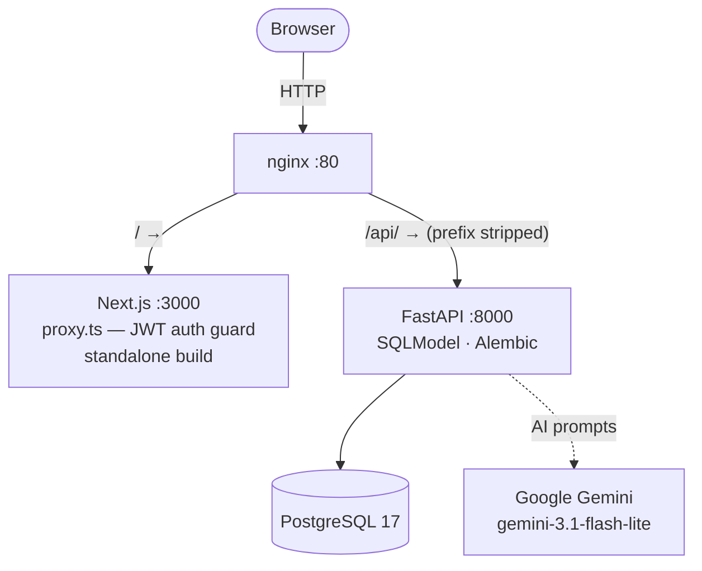
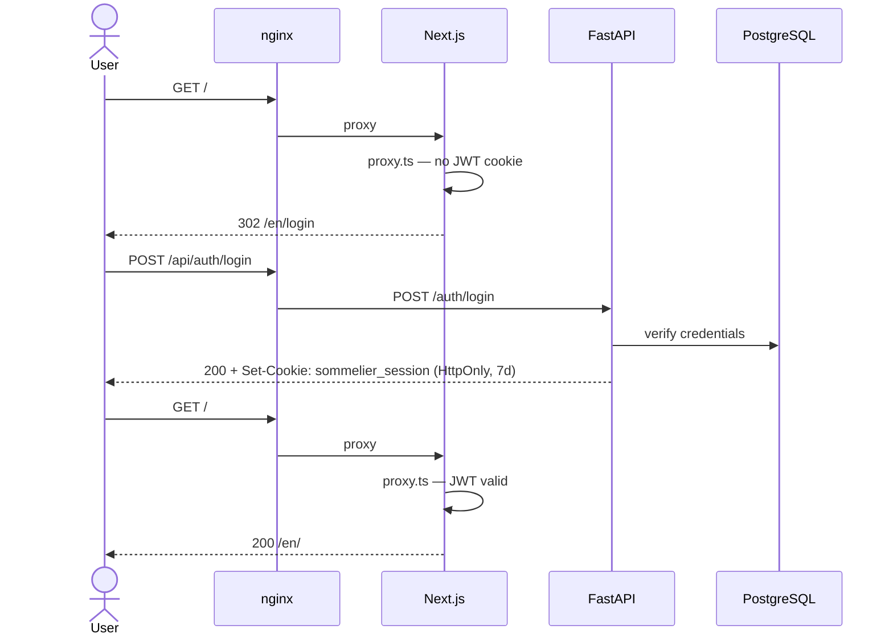
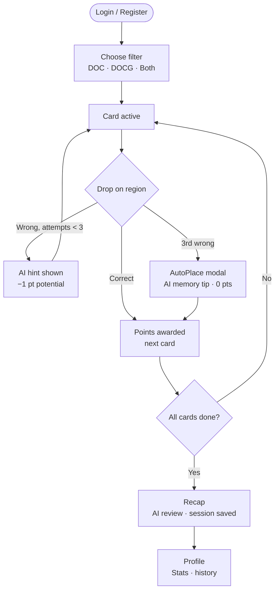
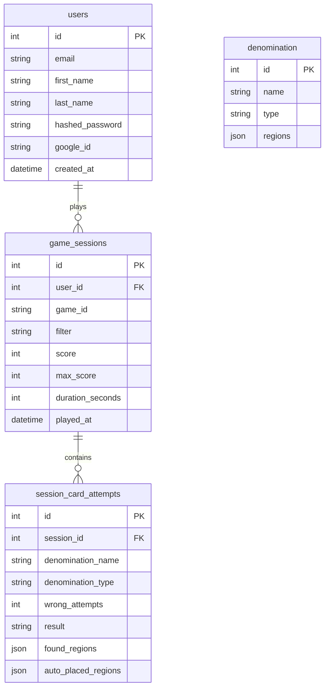

# Sommelier Game

> An interactive learning tool for sommelier students to master Italian wine geography through drag-and-drop.

Place **DOC** and **DOCG** wine denomination cards onto the correct regions of an SVG map of Italy. Get AI-powered hints when you're wrong, earn points for precision, review your session with a full AI recap, and track your progress over time in the personal area.

---

## Architecture



### API routes

| Method | Path | Description |
|--------|------|-------------|
| POST | `/auth/register` | Create account, set cookie |
| POST | `/auth/login` | Verify credentials, set cookie |
| POST | `/auth/logout` | Clear cookie |
| GET | `/auth/me` | Return current user |
| GET | `/auth/google` | Start Google OAuth flow |
| GET | `/auth/google/callback` | Finish OAuth, set cookie |
| GET | `/denominations` | Serve wine catalogue |
| POST | `/hint` | AI hint after wrong drop |
| POST | `/memorize` | AI tip in auto-place modal |
| POST | `/review` | AI recap at session end |
| POST | `/session` | Save completed session |
| GET | `/session/stats` | Aggregated profile stats |
| GET | `/health` | |

### Repo layout

```
sommelier_game/
├── frontend/      # Next.js app
├── backend/       # FastAPI + SQLModel + Alembic
│   └── data/      # denominations.json (ingestion source)
├── infra/         # docker-compose, nginx config, .env
├── docs/adr/      # Architecture Decision Records
└── start.sh       # single-command startup (hot-reload dev)
```

---

## Getting started

### Prerequisites

- Docker Desktop
- Node.js 20+ *(hot-reload dev only)*
- Python 3.12+ with [uv](https://docs.astral.sh/uv/) *(hot-reload dev only)*
- A Gemini API key

---

### Option A — Docker (recommended)

All services run in containers behind nginx. The stack is production-equivalent.

```bash
# 1. Create the environment file
cp infra/.env.example infra/.env
#    Edit infra/.env and set at minimum:
#      JWT_SECRET     — run: openssl rand -hex 32
#      GEMINI_API_KEY — your Google AI Studio key

# 2. Build and start
docker compose -f infra/docker-compose.yml up --build
```

The app is available at **http://localhost**.

On subsequent runs `--build` can be omitted unless source files changed.

> **Google OAuth with Docker:** set `GOOGLE_REDIRECT_URI=http://localhost/api/auth/google/callback` in `infra/.env` and register the same URI in Google Cloud Console.

---

### Option B — Hot-reload dev (`start.sh`)

Runs Next.js and FastAPI natively for fast iteration. Requires Node.js, Python, and uv installed locally.

```bash
# 1. Configure backend
cp backend/.env.example backend/.env
#    Set GEMINI_API_KEY, JWT_SECRET, and GOOGLE_* (see file for instructions)

# 2. Configure frontend
cp frontend/.env.local.example frontend/.env.local
#    Set JWT_SECRET to the same value as backend/.env

# 3. Start everything
./start.sh
```

`start.sh` starts PostgreSQL (Docker), runs Alembic migrations, ingests the denomination catalogue, then starts both servers. Frontend on `localhost:3000`, backend on `localhost:8000`.

On subsequent runs `./start.sh` is all you need — migrations and ingestion are idempotent.

---

### Google OAuth setup

1. Create a project in [Google Cloud Console](https://console.cloud.google.com/)
2. APIs & Services → OAuth consent screen (External, add `email` + `profile` scopes)
3. Credentials → OAuth client ID (Web application), add authorized redirect URIs:
   - Docker: `http://localhost/api/auth/google/callback`
   - `start.sh` dev: `http://localhost:8000/auth/google/callback`
4. Copy Client ID and Secret into your `.env` file

Google OAuth is optional — email/password registration works without it.

---

## Development

### Frontend (Next.js)

```bash
cd frontend
npm run dev        # http://localhost:3000
npm run build      # production build — run before committing
npm run test       # Vitest unit tests
npm run test:watch # TDD watch mode
```

### Backend (FastAPI)

```bash
cd backend
uv run fastapi dev app/main.py   # http://localhost:8000
uv run pytest                    # test suite
```

### Database

```bash
# Start / stop PostgreSQL only
docker compose -f infra/docker-compose.yml up -d db
docker compose -f infra/docker-compose.yml stop

# Migrations (after changing a model)
cd backend
uv run alembic revision --autogenerate -m "describe change"
uv run alembic upgrade head

# Re-ingest denomination catalogue
uv run python scripts/ingest_denominations.py data/denominations.json
```

### E2E tests (Playwright)

**Prerequisite: full stack must be running** (`./start.sh` or `docker compose up`, servers on `:3000` and `:8000` respectively).

```bash
# From /frontend
npx playwright install --with-deps chromium   # first time only
npm run test:e2e                               # run all E2E tests headlessly
npm run test:e2e -- --headed                  # watch with browser visible
npm run test:e2e -- e2e/auth.spec.ts          # single file
```

The E2E global setup creates a test user and saves the session cookie to `playwright/.auth/user.json` (gitignored). Google OAuth is not covered by E2E tests — test manually.

---

## Auth flow



---

## How the game works



### Scoring

| Wrong attempts  | Points |
|:---------------:|:------:|
| 0               | 3      |
| 1               | 2      |
| 2               | 1      |
| 3 (auto-placed) | 0      |

Multi-region denominations (e.g. Prosecco spans Veneto + Friuli Venezia Giulia) must be placed in **all** correct regions. A single wrong-attempt counter tracks the whole card.

---

## Tech stack

| Layer | Technology |
|-------|-----------|
| Reverse proxy | nginx (Docker) |
| Frontend | Next.js 16 (App Router, standalone output) + TypeScript + Tailwind CSS |
| Auth (frontend) | `jose` (JWT verification in proxy), `AuthContext` React context |
| Drag & Drop | dnd-kit with custom SVG collision detection |
| Map | `@svg-maps/italy` (20 regions) |
| i18n | next-intl — EN / IT |
| Backend | FastAPI + Python 3.12, managed with uv |
| Auth (backend) | `python-jose` (JWT), `passlib[bcrypt]` (passwords), `authlib` (Google OAuth) |
| ORM / schema | SQLModel + Alembic |
| Database | PostgreSQL 17 |
| AI | Google Gemini `gemini-3.1-flash-lite` |
| Frontend tests | Vitest (unit) + Playwright (E2E) |
| Backend tests | pytest + httpx |

---

## Data model



**Denomination catalogue** — 410 entries covering all Italian DOC and DOCG appellations, stored in `backend/data/denominations.json` and ingested into PostgreSQL at startup:
```json
{ "name": "Prosecco", "type": "DOC", "regions": ["Veneto", "Friuli Venezia Giulia"] }
```
`regions` is always an array — many denominations span multiple regions.

---

## Deployment (Coolify)

Production is deployed to a self-hosted Coolify server at **tanninoincazzato.it**.

### Architecture

Coolify's built-in Traefik reverse proxy terminates TLS (Let's Encrypt) for the domain and forwards traffic to the app's nginx container on port 80 over the internal Docker network. nginx continues to do path-based routing (`/` → frontend, `/api/` → backend, prefix stripped) as described in [ADR 0001](docs/adr/0001-nginx-path-based-routing.md). This two-proxy design keeps the nginx container decoupled from TLS concerns and the frontend build (which pins `NEXT_PUBLIC_API_URL=/api`) unmodified.

This Coolify server hosts **multiple apps** (also `gestionale.hair-garage.it`), so routing is wired with **explicit Traefik labels** on the nginx service in `infra/docker-compose.prod.yml` — not via Coolify's per-service domain field. The nginx container joins the shared external `coolify` Docker network (where Traefik lives) and declares:

- an HTTPS router matching `Host(tanninoincazzato.it) || Host(www.tanninoincazzato.it)`, with `tls.certresolver=letsencrypt` (one cert, both SANs);
- a `www → apex` 301 redirect (`redirectregex` middleware) and an `http → https` 301 redirect.

All router/middleware names are prefixed **`sommelier-`** so they never collide with the other app's Traefik config on the same proxy. The external network is declared as:

```yaml
networks:
  coolify:
    external: true
```

### Image registry

Images are pulled from ghcr.io:

- `ghcr.io/luke035/sommelier_game/backend:latest`
- `ghcr.io/luke035/sommelier_game/frontend:latest`

The prod compose stack is defined in `infra/docker-compose.prod.yml`.

**Registry credentials.** Coolify has **no UI for registry credentials** — it reads the host Docker daemon's auth. Authenticate once on the server via SSH (as the user Coolify connects with, usually `root`):

```bash
echo '<PAT>' | docker login ghcr.io -u luke035 --password-stdin
```

The packages are private and **linked to a private repository**, so a `read:packages`-only token returns `unauthorized` on pull. The classic PAT must have **both `read:packages` and `repo`** scopes. Verify with `docker pull ghcr.io/luke035/sommelier_game/backend:latest`.

### Database

The database is a Coolify-managed PostgreSQL 17 instance (not in the compose stack). `DATABASE_URL` is set as a Coolify environment variable and injected into the backend container at runtime. This removes the need to manage backups or upgrades manually.

Use the **internal** connection string (host = the DB container's name, e.g. its Coolify UUID; port `5432`) and make sure the scheme is `postgresql://`, not `postgres://` (psycopg2 requires it). Alembic only creates **tables** inside an existing database — the database itself must already exist (Coolify creates it from the name set when provisioning the resource).

**Network connectivity.** The managed Postgres lives on Coolify's shared `coolify` network and is not published to the host, so the app must share that network to resolve it by name (otherwise the backend fails with `could not translate host name … Temporary failure in name resolution`). Enable **"Connect To Predefined Network"** on the Compose resource so all services join `coolify`. This is safe alongside other apps on the same server — container names are unique and each stack keeps its own internal network for service-to-service DNS.

### Automated deployment

The GitHub Actions workflow `docker-publish.yml` pushes images to ghcr.io after tests pass. Its `deploy` job then calls a Coolify webhook (`COOLIFY_WEBHOOK_URL` + `COOLIFY_TOKEN` secrets) to trigger a fresh deployment using the latest images.

### Required environment variables

Set these in Coolify's environment editor for the app:

| Variable | Value |
|----------|-------|
| `JWT_SECRET` | Random 32-byte hex string (shared with frontend) |
| `DATABASE_URL` | External Postgres connection string (provided by Coolify) |
| `GEMINI_API_KEY` | Google AI Studio API key |
| `GOOGLE_CLIENT_ID` | Google OAuth Client ID |
| `GOOGLE_CLIENT_SECRET` | Google OAuth Client Secret |
| `GOOGLE_REDIRECT_URI` | `https://tanninoincazzato.it/api/auth/google/callback` |
| `FRONTEND_URL` | `https://tanninoincazzato.it` |
| `CORS_ORIGINS` | `https://tanninoincazzato.it` |
| `COOKIE_SECURE` | `true` |

### Google Console setup

1. Register the redirect URI `https://tanninoincazzato.it/api/auth/google/callback` in the OAuth consent screen.
2. Add `tanninoincazzato.it` to **Authorized domains** in the consent screen.

### Local dev note

When switching to PostgreSQL 17 locally, existing volume data from PG16 is incompatible. Run this once:
```bash
docker compose -f infra/docker-compose.yml down -v
```
This deletes local data only — migrations and ingestion repopulate on the next `./start.sh`.

Regions in `found_regions` / `auto_placed_regions` are stored as SVG IDs (e.g. `"apulia"`, `"tuscany"`). The profile page converts them to display names via `svgIdToDisplay()`.
